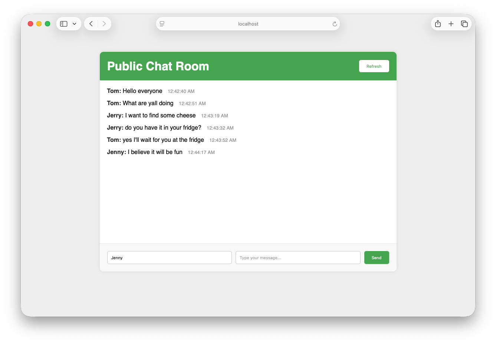
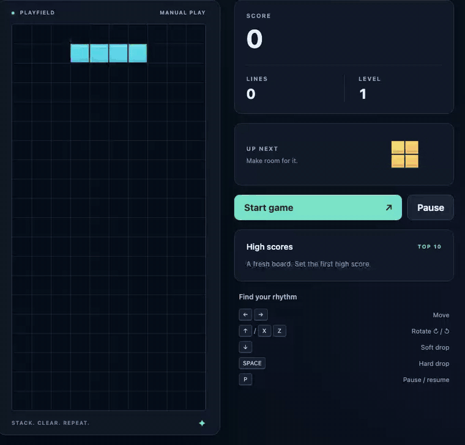
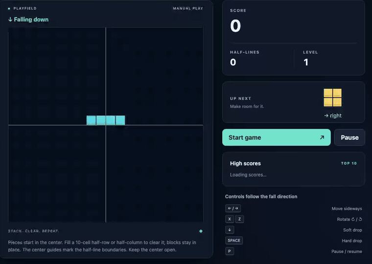
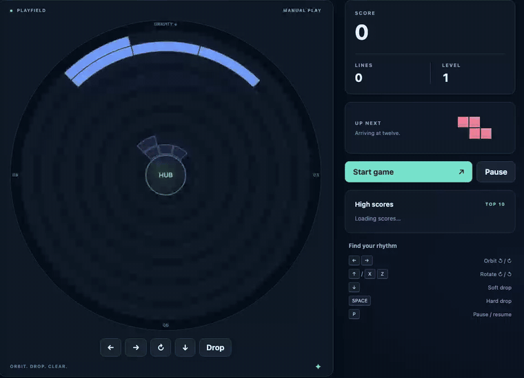
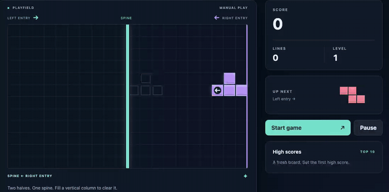

# EN.601.727 Machine Programming - Assignment 3

🚀 Welcome to Assignment 3!

In this assignment, you'll build **WAA (Web-App Agent)**, an LLM-powered coding agent that autonomously creates web applications from natural language instructions.
Think of it as your own personal developer assistant that can read requirements, write code, run tests, and iterate until everything works.

This is where everything comes together: you've explored program synthesis in Assignment 1 and evaluated LLM code generation in Assignment 2. Now you'll build a full agentic system that uses tools, manages state, and creates real applications!

### ✨ Structure

This assignment is divided into three parts that build on each other:

- **Part 1: Agentic Loop**
  Implement the core agent loop: loading tools, building prompts, querying the LLM, and executing tool calls. This is the "brain" of your agent.

- **Part 2: Tools**
  Build essential tools for your agent: file system operations (read, write, edit) and TODO management. These are the "hands" of your agent.

- **Part 3: Building Web Applications**
  Use your completed agent to build a chat room, a Tetris variant of your own design (in three milestones), and a creative project of your choice. Watch your agent work its magic! ✨

### 📦 Deliverables and Submission

You will implement the following:

- **Part 1: Agent Core**
  - `waa/agent.py`: Tool registry setup, system prompt, user instruction loading, LLM querying, tool execution, main loop

- **Part 2: Tools**
  - `waa/tools/fs.py`: File system tools (read, write, edit, delete, mkdir, rmdir, ls, tree)
  - `waa/tools/todo.py`: TODO management tools (add, list, complete, remove)

- **Part 3: Web Applications**
  - `targets/chat_room/`: An interactive chat room
  - `targets/tetris/`: Your Tetris variant, including its `.waa/logs/`
  - `targets/YOUR_CREATIVE_IDEA/`: A web app of your own design
  - `report.pdf`: Screenshots and documentation of your web apps

### 📌 Grading Criteria

- **Parts 1 & 2 (50%)**: Autograded. Full credit if you pass all tests.
- **Part 3 (50%)**: Manually graded by the instructor and TA based on:
  - Completion of the chat room (10%)
  - Completion of your Tetris variant across all three milestones (20%)
  - Creativity and completeness of your own web app (20%)

For Gradescope submission, zip the entire `waa/` directory and `targets/` directory using a script `package_submission.sh` (if you are running on Unix).
Once you have the related files available (e.g., `report.pdf`, `acknowledgement.md`, `extra_credits.md`, etc.), directly modify the `package_submission.sh` script to include them in the output zip.

### 🤝 Collaboration Policy

You are encouraged to discuss ideas with peers.
Do not copy code directly.
Implement your own solution.
If you collaborate (e.g., pair programming, brainstorming), credit your collaborators clearly in your `acknowledgements.md`.

### 🤖 Using AI in This Assignment

This is a Machine Programming course—of course you can use LLMs to help you code!
However, this assignment is about **building** an agent, not just using one.
Make sure you understand the architecture and how all pieces fit together.
LLMs can help debug, but the design decisions should be yours.
Document interesting prompts and AI assistance in your `acknowledgements.md`.

### 🔑 LLM API Key

For Part 3, we will provide the first set of Amazon Bedrock API keys. For subsequent keys, use your own Bedrock account and follow the [AWS setup tutorial](https://machine-programming.github.io/tutorials/aws/tutorial.pdf).
This key is intended for use only within the context of this course.
Please do not share it with others, especially outside of the class.

To use your key, set it as an environment variable:

```bash
export AWS_BEARER_TOKEN_BEDROCK="your_api_key_here"
```

Typical usage for this assignment should not exceed $20.
We will monitor usage, and in cases of excessive or inappropriate use, keys may be revoked.

> If you accidentally publish your API key, contact the course staff to have it revoked and replaced.

### 🧭 Integrity Guidelines

- **Do not build the websites manually!** The whole point is to let your agent do the work. We'll be checking the agent logs.
- Don't hardcode answers to test cases—your agent should genuinely solve problems using its tools.
- Do not fake LLM outputs. Both successes and failures are learning opportunities.
- Please do not publicize your solutions online.

# 🚀 Part 0: Setting Up

Let's get your development environment ready!

## 0.1. Clone the Repository

```bash
git clone https://github.com/machine-programming/assignment-3
cd assignment-3
```

## 0.2. Create Virtual Environment

```bash
python -m venv .venv
source .venv/bin/activate  # On Fish: source .venv/bin/activate.fish
pip install -r requirements.txt
```

## 0.3. Test Your Setup (It's Okay If Tests Fail!)

```bash
python tests/test_fs_mock_agent.py
```

You should see the tests run but **fail**. That's expected! Your job is to make them pass.

## 0.4. Install Node.js and npm

WAA builds web applications, so you'll need Node.js and npm installed:

1. **Download and install Node.js** from [nodejs.org](https://nodejs.org/) (LTS version recommended)
2. **Verify installation**:
   ```bash
   node --version  # Should show v18.x or later
   npm --version   # Should show 9.x or later
   npx --version   # Should show 9.x or later
   ```

## 0.5. Install WAA in Development Mode

```bash
pip install -e .
```

This installs WAA so you can run it from anywhere. Verify it works:

```bash
waa --help
```

You should see the help message for the WAA command-line tool!

# 🧠 Part 1: The Agentic Loop

Time to build the brain of your agent! In this part, you'll implement the core agentic loop that powers WAA.

Before diving in, take some time to explore `waa/agent.py` and understand its structure. The agent follows a simple but powerful pattern:
1. Load tools and build a system prompt
2. Load user instructions
3. Loop: Query LLM → Parse response → Execute tool or terminate
4. Repeat until max turns or termination

## 1.1. Initialize Tool Registry

Open `waa/agent.py` and find the `initialize_tool_registry()` method.

Your agent needs tools to interact with the world. We've already implemented three sets of tools for you as examples:

- **Server Tools** (`waa/tools/server.py`): Manage npm and Node.js servers
  - `npm.init`: Set up a new Node.js project with package.json
  - `npm.start`: Start the development server in the background
  - `npm.stop`: Stop the running server
  - `npm.status`: Check if the server is running
  - `npm.logs`: View server logs

- **Testing Tools** (`waa/tools/supertest.py` and `waa/tools/playwright.py`):
  - `supertest.init`: Set up Jest and Supertest for API testing
  - `supertest.run`: Run API tests on your Express server
  - `playwright.init`: Set up Playwright for UI testing (runs a real Chrome browser!)
  - `playwright.run`: Run UI tests to verify webpage elements

These tools are already complete and serve as examples for your implementation in Part 2.
You should find the additional tools in `waa/tools/fs.py` and `waa/tools/todo.py`.
While those have not been fully implemented yet, just import them and register them into your registry.

Please make sure that only the `allowed_tools` are registered though!

## 1.2. Build the System Prompt

Find the `load_system_prompt()` method in `waa/agent.py`.

The system prompt is crucial—it teaches your LLM how to be an agent. Your system prompt should include:

- Tool calling protocol:
    ```
    <tool_call>{"tool": "TOOL_NAME", "arguments": {"arg1": "value1", "arg2": "value2"}}</tool_call>
    ```
- Termination protocol:
    ```
    <terminate>
    ```
- Thinking protocol
- Tool Descriptions
- High-Level Strategy such as initialization first, how to structure files, and when to terminate, etc.

See the existing tests in `tests/` for examples of tool calling in action.
These tests use a mock LLM with hardcoded responses, showing you exactly how the protocol works.

When the system prompt is generated, it should appended as a `SystemPrompt` entry in the `history` that the agent is tracking (see `waa/history.py`).

## 1.3. Load User Instructions

Find the `initialize_instruction()` method in `waa/agent.py`.

When running WAA, users provide instructions in a special `.waa` directory:
```
your-project/
├── .waa/
│   ├── config.json       # Agent configuration
│   └── instruction.md    # What to build
├── index.js              # Created by agent
└── ...                   # Other files created by agent
```

Check out `targets/tetris/.waa/instruction.md` for an example!

Your task for this is to load the instruction file from `.waa/instruction.md` and append  a `UserInstruction` history entry (see `waa/history.py`) to `self.history`.

## 1.4. Query the LLM

Implement the `query_llm()` method in `waa/agent.py`.

This is where you actually talk to the LLM!
At a high level, you should call `self.llm.generate(messages)` to get a response.
After that, you should append a `LLMResponse` history entry with the response to `self.history`.

Don't forget to add logging! Use `self.logger.log_llm_query()` and `self.logger.log_llm_response()` to track what's happening.

## 1.5. Execute Tools

Implement the `execute_tool()` method in `waa/agent.py`.

When the LLM wants to use a tool, it outputs a JSON object. Your job:
1. Extract `tool_name` and `arguments` from the tool call
2. Get the tool from `self.tool_registry`
3. Validate the arguments using `tool.schema.validate()`
4. Execute the tool with `tool.execute(arguments)`
5. Handle any errors gracefully—don't crash!
6. Create a `ToolCallResult` history entry and append to history

**Important**: Errors should not crash the agent! Catch exceptions and save error messages so the LLM can see what went wrong and try again.

## 1.6. Run the Agent Loop

Implement the `run()` method in `waa/agent.py`.

This is where everything comes together! The agent should:
1. Call `initialize()` to set up everything
2. Loop for `max_turns`, and in each iteration:
   - Query the LLM
   - Check if the response contains `<terminate>` → if so, break and finish
   - Check if the response contains `<tool_call>` → if so, parse and execute it
3. If the loop completes without termination, handle the max turns case

## 1.7. Test Your Agent Core

Time to see if it works! Run the server management tests:

```bash
python tests/test_server_mock_agent.py
```

These tests verify that:
- Your agent can initialize and manage npm servers
- Tool calls are executed correctly
- The agent loop terminates properly

This will also verify that `npm` is installed correctly on your system.

💡 **Debugging tip**: If tests fail, check the `.waa/agent.log` files created during test runs. They show exactly what your agent is doing!

# 🛠️ Part 2: Building Tools

Now you'll give your agent the ability to manipulate files and track progress. Tools are how agents interact with the world!

## 2.1. Understanding Tools

Every tool in WAA follows the same pattern. Open any of the existing tools (e.g., `waa/tools/server.py`) to see the structure.

Each tool must implement four key methods:
- `__init__`: Set the tool name and register arguments using `self.schema.register_argument()`
- `initialize`: Load configuration from the `AgentEnvironment` (e.g., working directory, protected files)
- `description`: Return a string describing what the tool does, when to use it, and what arguments it expects
- `execute`: Perform the tool's action given input arguments, returning a dict with `ok`, `data`, and `error` fields

**Key principles:**
- Always return a dict with `ok`, `data`, and `error` fields
- Never crash! Catch exceptions and return error messages
- Provide helpful error messages—the LLM needs to understand what went wrong

## 2.2. File System Tools

Time to implement the file system tools in `waa/tools/fs.py`!

Your agent needs to create, read, edit, and delete files. Implement these tools:

Implement the following tools in `waa/tools/fs.py`:

- **`fs.write`**: Create or overwrite a file. Creates parent directories if needed. Must check path is within working directory and not protected.
- **`fs.read`**: Read a file. Returns file content, size, and line count. Validates path is within working directory.
- **`fs.edit`**: Edit a file with find-replace. Replaces the first occurrence of `old_text` with `new_text`. Must check protected files.
- **`fs.delete`**: Delete a file. Must check protected files.
- **`fs.mkdir`**: Create a directory. Creates parent directories automatically.
- **`fs.rmdir`**: Delete a directory. Supports `recursive` argument (default: false).
- **`fs.ls`**: List directory contents. Returns array of entries with name, type, and size.

See `tests/test_fs_mock_agent.py` for detailed usage examples of each tool.

### Security Features

**Critical**: Implement two security checks:

1. **Path validation**: All paths must stay within the working directory. Resolve the full path and verify it starts with the working directory path.

2. **Protected files**: Read `protected_files` from config in `initialize()` using `env.get_config_value("protected_files", [])` and prevent writes/deletes to those files.

### Test Your File System Tools

```bash
python tests/test_fs_mock_agent.py
```

This runs tests with a mock LLM, verifying that all file operations work correctly.

## 2.3. TODO Management

Implement the TODO tools in `waa/tools/todo.py`!

TODO lists help your agent track progress on complex tasks. The TODO list is stored as JSON in `.waa/todo.json`.

Implement these four tools:
- **`todo.add`**: Add a new TODO item. Generate unique ID, set status to "pending", record creation timestamp.
- **`todo.list`**: List TODO items. Support optional `status` filter: "pending", "completed", or "all" (default).
- **`todo.complete`**: Mark item as completed by ID. Update status and record completion timestamp.
- **`todo.remove`**: Remove a TODO item by ID.

Each TODO item should have: `id`, `description`, `status`, `created_at`, and optionally `completed_at`. Store the list as a JSON array in `.waa/todo.json`.

See `tests/test_todo_mock_agent.py` for detailed usage examples.

### Test Your TODO Tools

```bash
python tests/test_todo_mock_agent.py
```

# 🌐 Part 3: Building Web Applications

This is where the magic happens! You'll use your completed WAA agent to build a chat room, a Tetris game of your own design, and a creative web app of your choice.
Before proceeding, make sure that all tests pass for Part 1 and Part 2!

## 3.0. Understanding WAA Usage

### Running WAA

```bash
waa --working-dir YOUR_WORKING_DIRECTORY
```

Or from within a working directory:
```bash
cd targets/tetris
waa
```

### Debug Mode

Watch your agent think in real-time:
```bash
waa --working-dir targets/tetris --debug
```

This prints all LLM responses and tool calls to your terminal. It's incredibly helpful for understanding what your agent is doing!

### Working Directory Structure

Every WAA project needs this structure:
```
my-project/
├── .waa/
│   ├── config.json       # Agent configuration
│   └── instruction.md    # What to build
└── (agent creates files here)
```

### Logging

WAA generates logs during execution:
```
.waa/
├── agent.log       # Agent activity (LLM queries, tool calls)
├── server.log      # Server output (when running npm start)
├── todo.json       # TODO list state
└── ...
```

**Important**: Check `agent.log` to understand what your agent is doing! This is crucial for debugging.

### Adding Logging to Your Agent

Before running WAA on real projects, add logging calls throughout your `agent.py` implementation. Use the logger methods like `log_system_prompt()`, `log_user_instruction()`, `log_llm_query()`, `log_llm_response()`, `log_tool_call()`, `log_tool_result()`, and `log_termination()` at appropriate places. This creates a complete record of your agent's behavior!

### Rerun

In general, we would like to observe a single run of agent without interference.
Therefore we have disallowed agent to proceed when the file `.waa/agent.log` is present.
Please reset the folder structure to its original form (esp. deleting the `.waa/agent.log`) and try again.

## 3.1. Chat Room

First, you'll build an interactive chat room with both frontend and backend!



### Setup

1. Navigate to the chat room directory
2. Read the instruction at `targets/chat_room/.waa/instruction.md`
3. Customize it with your own ideas:
   - What should the chat room look like?
   - What features do you want? (usernames, timestamps, message history?)
   - Any special styling?
4. Important: Keep the test-related parts unchanged!

### Understanding the Architecture

A chat room needs:
- **Backend** (`index.js`): Express server with WebSocket or HTTP endpoints
- **Frontend** (`index.html`, `style.css`, `script.js`): UI for sending/receiving messages
- **API endpoints**: For posting and retrieving messages
- **Real-time updates**: Either polling or WebSocket

### Understanding the Tests

This project has **two types of tests**:

#### API Tests (`tests/api.test.js`)
Test the backend using Supertest:
```javascript
test('POST /message should accept a message', async () => {
  const response = await request(app)
    .post('/message')
    .send({ user: 'Alice', text: 'Hello!' });
  expect(response.status).toBe(200);
});
```

#### UI Tests (`tests/ui.test.js`)
Test the frontend using Playwright:
```javascript
test('should send and display a message', async ({ page }) => {
  await page.goto('http://localhost:3000');
  await page.fill('#username', 'Alice');
  await page.fill('#message', 'Hello world!');
  await page.click('#send-button');
  await expect(page.locator('text=Hello world!')).toBeVisible();
});
```

Read both test files carefully! They tell you exactly what your chat room should do.

### Running Your Agent

```bash
waa --working-dir targets/chat_room --debug
```

This has both a frontend and a backend, so expect it to take a good number of turns!

## 3.2. Design Your Own Tetris

Time to make a game! You'll design the rules of your own Tetris variant and let your agent build it in three milestones: core mechanics, rules and scoring, and a leaderboard. Your project lives in `targets/tetris/`, which starts with Milestone 1 only.

### What Counts as a Tetris?

The provided **What Counts as a Tetris** sections in `targets/tetris/.waa/instruction.md` list the rules every game must follow. Rules 8–11 arrive with Milestone 2. In short, your game needs:
- A finite arena of cells
- All seven tetrominoes, with one active piece at a time
- Gravity that speeds up over time
- Moving, rotating, collision, and settling
- Line clears, with scoring that rewards clearing several lines at once
- Game over when a new piece can't enter
- Start, pause, and restart

Everything else is up to you! The only catch: your game must differ from classic Tetris in at least one of **arena shape, entry point, gravity direction, what a line is, or what happens after a clear**. A new theme or scoring table isn't enough.

### Some Ideas



**Classic** (the baseline, which you can't submit). Pieces enter at the top of a 10×20 board and fall down. Full rows clear.



**Center.** Pieces start in the middle of a 20×20 board, and each falls in a random direction (up, down, left, or right). Full half-rows and half-columns clear, and nothing shifts.



**Round.** Pieces enter at the outer edge of a ring and fall inward toward the hub. Full rings clear, and the outer rings move in.



**Side.** Pieces enter from the left or right edge and slide toward a wall in the middle. Full columns on either side clear, and the outer columns move in.

You can build one of these (Center, Round, or Side) or invent your own!

### Setup

1. **Read the provided sections** of `targets/tetris/.waa/instruction.md`: What Counts as a Tetris and Common Interface.
2. **Fill in the three student sections** at the top:
   - **Current Milestone**: the milestone the agent should work on now
   - **My Variant**: your game's rules. That means the arena shape and size, where pieces enter, which way they fall, what a line is, what happens after a clear, the randomizer, controls, scoring, and speed.
   - **Look and Feel**: colors, theme, layout, and effects
3. **Important**: Don't modify the provided sections, the provided tests, or `jest.config.js`!

Be precise in **My Variant**! Wherever you leave a gap, the agent fills it with its own choice.

### Understanding the Tests

Every game exposes the same small JavaScript interface, `window.__tetris`, described in the **Common Interface** sections. That's how one set of tests can check any variant, whatever its board looks like. Through it, tests start a game with a fixed seed, read the state, and move pieces themselves. Opening the page with `?test=1` turns off automatic gravity, so the tests control every step.

You and your agent see the same tests, and there are no hidden ones. They only check that your game is a working Tetris, not that it follows your own rules, so play it yourself too! You can also write your own tests in `tests/extra/` (Playwright files must be named `ui.test.js`).

To run the tests yourself, start the game in one terminal:
```bash
cd targets/tetris
node index.js
```

Then run the tests in another:
```bash
cd targets/tetris
npx playwright test tests/m1_core/ui.test.js    # UI tests need the game running
npx jest tests/m3_leaderboard/api.test.js       # API tests don't
```

### Releasing Milestones

Milestones 2 and 3 wait in `milestones/tetris/`, where your agent can't see them. When you reach one, copy in its tests and add its instructions once, from the assignment root. After each milestone, move the agent's log into `.waa/logs/` and keep a copy of your instruction there too. WAA won't start while `.waa/agent.log` exists, and these files are part of your submission. Each milestone below shows the commands.

**Back up your work** between milestones, outside `targets/` so the backup doesn't end up in your submission:
```bash
cp -r targets/tetris ../tetris_backup_m1
```

## 3.3. Milestone 1: Core Mechanics

**Goal:** Rules 1–7. Your arena, all seven pieces, entry, gravity, moving and rotating, soft and hard drop, collision, settling, and the next-piece preview.

1. Set **Current Milestone** to "Milestone 1: Core Mechanics", describe your game in **My Variant** (including its controls), and write **Look and Feel**.
2. Let your agent build it:
   ```bash
   waa --working-dir targets/tetris --debug
   ```
3. Run the M1 tests and play the game.
4. Save the log and your instruction:
   ```bash
   mkdir -p targets/tetris/.waa/logs
   mv targets/tetris/.waa/agent.log targets/tetris/.waa/logs/m1.log
   cp targets/tetris/.waa/instruction.md targets/tetris/.waa/logs/m1.instruction.md
   ```

**Done when** the M1 tests pass and the game plays the way your **My Variant** says.

## 3.4. Milestone 2: Rules and Scoring

**Goal:** Rules 8–11. Lines and clearing, scoring with a bonus for clearing several lines at once, speed that increases, game over, pause and restart, and the score display.

1. Release Milestone 2:
   ```bash
   cp -r milestones/tetris/m2_rules/tests targets/tetris/tests/m2_rules
   cat milestones/tetris/m2_rules/INTERFACE.md >> targets/tetris/.waa/instruction.md
   ```
2. Read the new sections at the end of `instruction.md` and the M2 tests. Set **Current Milestone** to "Milestone 2: Rules and Scoring", and add your rules for lines, clearing, scoring, levels, speed, and pausing to **My Variant**.
3. Run your agent again with the same command. It helps to tell it what already works from M1!
4. Run the M1 and M2 tests and play the game:
   ```bash
   npx playwright test tests/m1_core/ui.test.js tests/m2_rules/ui.test.js
   ```
5. Save the log and your instruction as in M1, using `m2` in the file names.

**Done when** the M1 and M2 tests pass and the game follows all eleven rules and your **My Variant**.

## 3.5. Milestone 3: Leaderboard

**Goal:** A leaderboard! When the game ends, the player can submit a name with their score, lines, and level. The server keeps scores in memory, rejects invalid submissions, and the page shows the best scores without reloading.

1. Release Milestone 3:
   ```bash
   cp -r milestones/tetris/m3_leaderboard/tests targets/tetris/tests/m3_leaderboard
   cat milestones/tetris/m3_leaderboard/INTERFACE.md >> targets/tetris/.waa/instruction.md
   ```
2. Read the new sections and the M3 tests. Set **Current Milestone** to "Milestone 3: Leaderboard", and add any leaderboard choices (validation limits, ties, how many scores to show) to **My Variant**.
3. Run your agent again.
4. Run all the tests and play the game:
   ```bash
   npx playwright test tests/m1_core/ui.test.js tests/m2_rules/ui.test.js tests/m3_leaderboard/ui.test.js
   npx jest tests/m3_leaderboard/api.test.js
   ```
5. Save the log and your instruction as in M1, using `m3` in the file names.

**Done when** all the tests pass and the game follows the rules and your **My Variant**.

## 3.6. Your Own Creative Website

Now it's your turn to be creative! Build anything you want using your agent.

### Ideas

Here are some possibilities:
- **Calendar and scheduling**: Create events, view by day/week/month
- **Polling sebsite**: Create polls, vote, see results in real-time
- **Social features** (forum, Q&A platform, social feed)
- **Productivity tools** (project tracker, kanban board, time tracker)
- **Interactive games** (The Snake Game, Pong, or anything that is interactive)

Be ambitious! This is your chance to build something impressive. It can even be another Tetris idea, as long as it's a separate project in its own folder.

### Setup

1. **Create your project directory**:
   ```bash
   mkdir targets/YOUR_PROJECT_NAME
   mkdir targets/YOUR_PROJECT_NAME/.waa
   ```

2. **Copy config.json** from another project:
   ```bash
   cp targets/tetris/.waa/config.json targets/YOUR_PROJECT_NAME/.waa/
   ```

3. **Adjust max_turns** if your project is complex:
   ```json
   {
     "max_turns": 75,
     "llm_type": "bedrock",
     "model": "us.anthropic.claude-sonnet-4-6"
   }
   ```

4. **Write your instruction.md**

Write clear, detailed instructions that specify:
- The core functionality and features
- Expected user interactions
- Visual design preferences
- Technical requirements (frontend-only vs. backend needed)
- Any test requirements

The more specific you are, the better your agent will perform.

### Running Your Agent

```bash
waa --working-dir targets/YOUR_PROJECT_NAME --debug
```

## 3.7. Report

Create a PDF report showcasing your work!

### What to Include

1. **Screenshots (or GIFs) of each project**:
   - Chat room: Screenshots showing message sending/receiving
   - Your Tetris variant: gameplay including a line clear, the game-over screen with the score form, and the leaderboard
   - Creative project: Screenshots demonstrating key features

2. **Brief descriptions**:
   - What you asked the agent to build, including what your Tetris variant changes from classic
   - How your **My Variant** text changed across the three milestones
   - What worked well
   - What challenges came up
   - How many turns it took
   - Any interesting observations

### Creating the PDF

Use any tool you like:
- Microsoft Word → Export as PDF
- Google Docs → Download as PDF
- LaTeX/Overleaf
- Markdown → Pandoc → PDF
- Apple Pages → Export as PDF

Save as `report.pdf` in the root of your submission.

# Extra Credit Opportunities (2% of Overall Course Grade)

You may get 2% of your overall grade if you do the following:

- Setup an environment with a Database (consider using MySQL, MongoDB, SQLite, or any online database providers).
- Have another tool that can interact with the Database: start and stop the database service, initialize a database, and perform database queries (including creating tables and making changes to the database).
- Build a Web-App that needs a Database!

Document any extra credit attempts in `extra_credit.md`.

# 🎯 Summary and Submission

We have prepared a shell script `package_submission.sh` for you to package your submission.
Running it will produce a `submission.zip` file in the directory.
Please modify the script to include all other files (e.g., `report.pdf`, `extra_credit.md`, `acknowledgements.md`, etc.) in the resulting `.zip` file.
After that, you can submit the zip file to GradeScope under Assignment 3.

Congratulations on building a complete LLM-powered coding agent! 🎉
